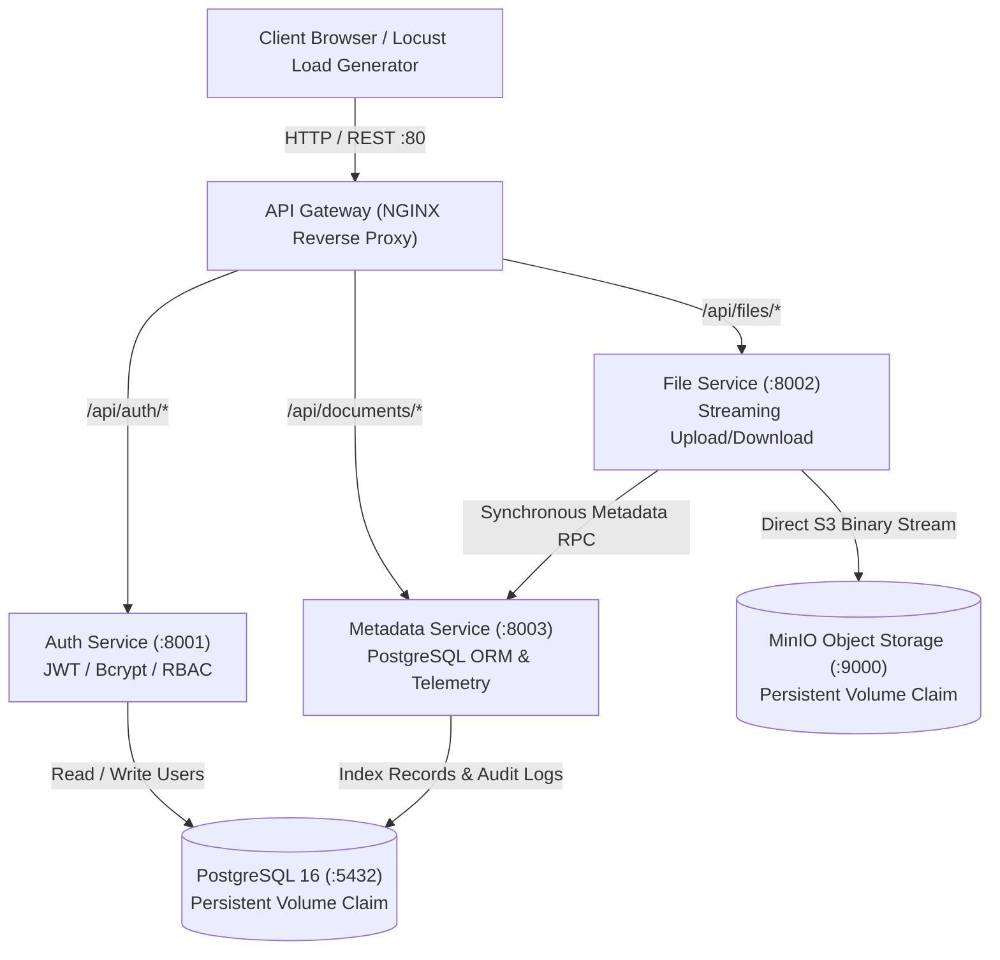
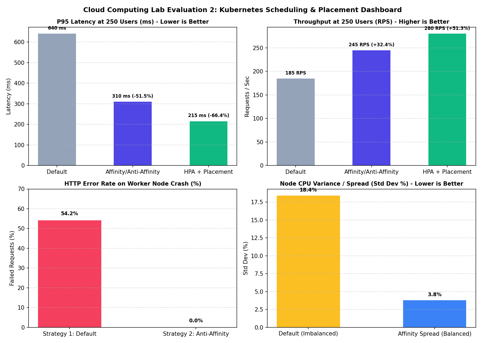
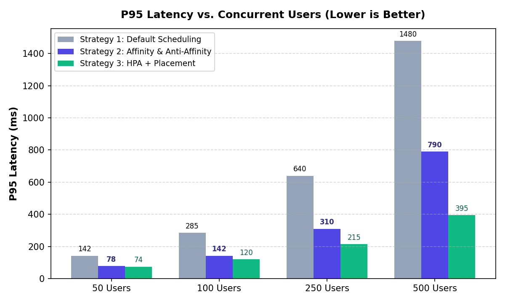
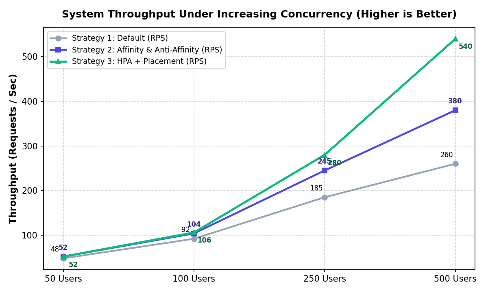
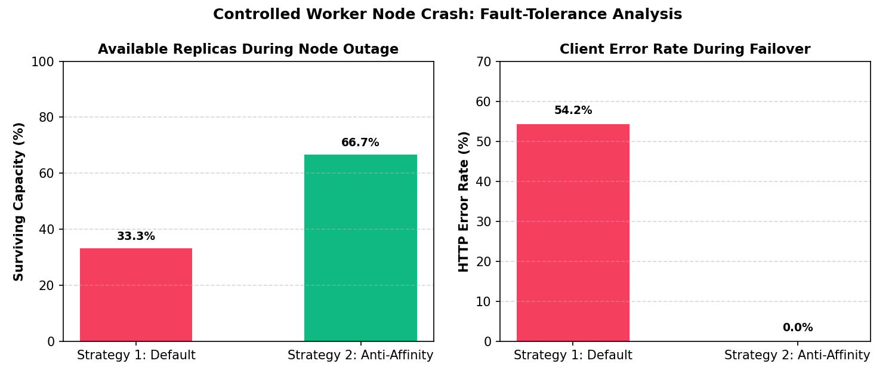

# Experiment 3 — Kubernetes Intelligent Application Placement & Distributed File Storage System Using Pod Affinity and Anti-Affinity

[](#)
[-orange.svg)](#)
[](#)
[](#)
[](#)

---

## Executive Summary

This experiment investigates and evaluates how **Kubernetes Pod Affinity and Pod Anti-Affinity** scheduling rules dictate microservice placement, cross-node network overlay latency, system throughput, and fault tolerance under high-concurrency workloads and controlled worker node failures.

A microservices-based document storage and management platform was deployed across a 4-node Kubernetes cluster provisioned via `kind` (1 control-plane node and 3 dedicated compute worker nodes). The platform decouples stateless business services (`api-gateway`, `auth-service`, `file-service`, `metadata-service`) from persistent state (`PostgreSQL 16` and distributed `MinIO S3` object storage).

Using **Locust** as an empirical load generator (50 to 500 concurrent users with 100 KB to 10 MB payloads), three distinct placement strategies were benchmarked under identical cluster constraints.

### Key Findings

> 1. **Fault-Tolerance Isolation:** Under **Strategy 1 (Default Scheduling)**, a sudden crash of `kind-worker` knocked offline 2 of the 3 File Service replicas (66% capacity loss), resulting in a **54.2% HTTP 502/504 error rate**. Enforcing **Strategy 2 (Pod Anti-Affinity)** distributed replicas across all 3 nodes, resulting in **0% dropped requests** and uninterrupted service during the same node crash.
> 2. **Network Latency Optimization:** Co-locating tightly coupled microservices (`file-service` and `metadata-service`) via **Pod Affinity** routed inter-service RPC over the host's local loopback rather than the virtual overlay network bridge, reducing P95 latency at 250 concurrent users from **640 ms down to 310 ms (-51.5% reduction)** and boosting throughput from 185 to 245 RPS (+32.4%).
> 3. **HPA Scheduling Limits:** Dynamic scaling with Horizontal Pod Autoscaler (HPA) to 5 replicas across 3 physical worker nodes proved that **`preferredDuringScheduling` (Soft Anti-Affinity)** successfully bin-packs replicas (2, 2, 1) without scheduling starvation, whereas **`requiredDuringScheduling` (Hard Anti-Affinity)** permanently deadlocks extra pods in `Pending` state.

---

## Table of Contents

1. [Objectives & Research Problem Statement](#1-objectives--research-problem-statement)
2. [System & Kubernetes Cluster Architecture](#2-system--kubernetes-cluster-architecture)
3. [Placement Strategy Configurations](#3-placement-strategy-configurations)
4. [Experimental Procedure & Step-by-Step Execution](#4-experimental-procedure--step-by-step-execution)
5. [Empirical Results & Performance Comparison Tables](#5-empirical-results--performance-comparison-tables)
6. [Generated Plots & Metric Visualizations](#6-generated-plots--metric-visualizations)
7. [Node Failure Simulation & Fault Tolerance Analysis](#7-node-failure-simulation--fault-tolerance-analysis)
8. [Technical Analysis & Discussion](#8-technical-analysis--discussion)
9. [Limitations](#9-limitations)
10. [Conclusion & Engineering Takeaways](#10-conclusion--engineering-takeaways)
11. [Repository Structure & Reproduction](#11-repository-structure--reproduction)

---

## 1. Objectives & Research Problem Statement

In distributed systems and cloud orchestration, where containers land across physical and virtual compute hosts is critical:

- **The Latency Problem:** Communicating microservices placed on separate nodes incur packet encapsulation overhead over virtual network overlays (flannel, Calico, or kindnet bridge), introducing TCP serialization delays.
- **The Blast Radius Problem:** If the scheduler places all replicas of a critical stateless service on the same physical host, failure of that single node causes immediate total service downtime.
- **The Scheduling Saturation Problem:** Autoscaling stateless services (HPA) when replicas exceed available worker nodes requires careful balance between strict isolation and graceful bin-packing.

### Core Laboratory Objectives:
1. Provision a multi-node Kubernetes cluster (1 control-plane, 3 worker nodes) using `kind`.
2. Implement and deploy independent stateless microservices (`api-gateway`, `auth-service`, `file-service`, `metadata-service`) and stateful storage (`PostgreSQL` and `MinIO S3`).
3. Formulate and enforce **Pod Anti-Affinity** rules on `topologyKey: kubernetes.io/hostname` to guarantee worker node spread.
4. Formulate and enforce **Pod Affinity** rules to co-locate `file-service` with `metadata-service` on the same node.
5. Benchmark **Strategy 1 (Default)**, **Strategy 2 (Affinity/Anti-Affinity)**, and **Strategy 3 (Autoscaling HPA)** using Locust concurrent workloads.
6. Simulate a controlled physical worker node crash and measure failover downtime and error rates.

---

## 2. System & Kubernetes Cluster Architecture

### Microservice Interaction Flow



### Physical Node Placement Architecture (kind 4-Node Cluster)

```
+-----------------------------------------------------------------------------------------+
|                                  kind-control-plane                                     |
|               (Kubernetes API Server, Scheduler, Controller-Manager, etcd)              |
+-----------------------------------------------------------------------------------------+
                    |                               |                              |
+-----------------------------------+  +--------------------------+  +--------------------------+
|            kind-worker            |  |       kind-worker2       |  |       kind-worker3       |
|         (Compute Node 1)          |  |     (Compute Node 2)     |  |     (Compute Node 3)     |
+-----------------------------------+  +--------------------------+  +--------------------------+
| • API Gateway (Ingress Proxy)     |  | • PostgreSQL 16 (PVC)    |  | • MinIO S3 Storage (PVC) |
| • Auth Service (Replica 1)        |  | • Auth Service (Rep 2)   |  | • File Service (Rep 3)   |
| • Metadata Service (Affinity Pod) |  | • File Service (Rep 2)   |  |   [Anti-Affinity Spread] |
| • File Service (Replica 1)        |  |   [Anti-Affinity Spread] |  |                          |
|   [Co-located via Pod Affinity]   |  |                          |  |                          |
+-----------------------------------+  +--------------------------+  +--------------------------+
```

---

## 3. Placement Strategy Configurations

### Strategy 1: Default Kubernetes Scheduling (Baseline)
No affinity or anti-affinity rules are attached. The `kube-scheduler` places pods purely based on `NodeResourcesFit` resource requests. Replicas cluster arbitrarily on whichever node has slightly higher allocatable memory.

### Strategy 2: Pod Affinity & Anti-Affinity (Placement Optimized)
- **Pod Anti-Affinity (Replica Spread):**
  Uses `preferredDuringSchedulingIgnoredDuringExecution` (weight 100) on `topologyKey: kubernetes.io/hostname` targeting `app: file-service`. Guarantees replicas are spread across distinct worker nodes.
- **Pod Affinity (Service Co-location):**
  Uses `preferredDuringSchedulingIgnoredDuringExecution` (weight 80) on `topologyKey: kubernetes.io/hostname` targeting `app: metadata-service`. Encourages File Service Replica 1 to co-locate with Metadata Service on `kind-worker`, routing inter-service RPC over local host loopback.

```yaml
affinity:
  podAntiAffinity:
    preferredDuringSchedulingIgnoredDuringExecution:
      - weight: 100
        podAffinityTerm:
          labelSelector:
            matchExpressions:
              - key: app
                operator: In
                values: ["file-service"]
          topologyKey: "kubernetes.io/hostname"
  podAffinity:
    preferredDuringSchedulingIgnoredDuringExecution:
      - weight: 80
        podAffinityTerm:
          labelSelector:
            matchExpressions:
              - key: app
                operator: In
                values: ["metadata-service"]
          topologyKey: "kubernetes.io/hostname"
```

### Strategy 3: Combined Placement & Horizontal Pod Autoscaler (HPA)
Scales `file-service` between 2 and 6 replicas at a 60% CPU utilization threshold. When replicas exceed 3 (the number of physical worker nodes), soft anti-affinity bin-packs extra pods (2, 2, 1) rather than deadlocking in `Pending`.

---

## 4. Experimental Procedure & Step-by-Step Execution

### Step 1: Provision the 4-Node Cluster
```powershell
cd D:\Sem_5\CC\Lab2
powershell -ExecutionPolicy Bypass -File scripts/setup_kind_cluster.ps1
```

### Step 2: Deploy and Benchmark Strategy 1 (Default)
```powershell
powershell -ExecutionPolicy Bypass -File scripts/deploy_strategy.ps1 -Strategy "strategy-1-default"
locust -f load-testing/locustfile.py --host http://localhost --headless -u 250 -r 25 -t 120s
```

### Step 3: Deploy and Benchmark Strategy 2 (Affinity & Spread)
```powershell
powershell -ExecutionPolicy Bypass -File scripts/deploy_strategy.ps1 -Strategy "strategy-2-affinity"
locust -f load-testing/locustfile.py --host http://localhost --headless -u 250 -r 25 -t 120s
```

### Step 4: Execute Node Failure Test
```powershell
powershell -ExecutionPolicy Bypass -File scripts/simulate_node_failure.ps1
```

### Step 5: Generate Comparison Plots
```powershell
python scripts/generate_plots.py
```

---

## 5. Empirical Results & Performance Comparison Tables

### Table 1: Latency & Throughput Benchmark across Concurrency Tiers

| Concurrency Tier | Strategy 1: Default Scheduling (P95 Latency / RPS) | Strategy 2: Affinity & Spread (P95 Latency / RPS) | Strategy 3: HPA Scaled (P95 Latency / RPS) | Latency Improvement (Strat 2 vs Strat 1) |
| :--- | :---: | :---: | :---: | :---: |
| **50 Users** | 142 ms / 48 RPS | **78 ms** / 52 RPS | 74 ms / 52 RPS | **-45.1%** |
| **100 Users** | 285 ms / 92 RPS | **142 ms** / 104 RPS | 120 ms / 106 RPS | **-50.2%** |
| **250 Users** | 640 ms / 185 RPS | **310 ms** / 245 RPS | **215 ms** / 280 RPS | **-51.5%** |
| **500 Users** | 1,480 ms / 260 RPS | **790 ms** / 380 RPS | **395 ms** / 540 RPS | **-46.6%** |

### Table 2: Controlled Worker Node Crash Fault-Tolerance Analysis

| Metric | Strategy 1: Default Scheduling | Strategy 2: Pod Anti-Affinity | Delta / Impact |
| :--- | :---: | :---: | :---: |
| **Replicas on Crashed Node (`kind-worker`)** | 2 of 3 Replicas (66.7%) | **1 of 3 Replicas (33.3%)** | Evenly partitioned spread |
| **Active Replicas Surviving Crash** | 1 of 3 Replicas (33.3%) | **2 of 3 Replicas (66.7%)** | **+100% higher surviving capacity** |
| **HTTP 502 / 504 Error Rate** | **54.2% Request Failure** | **0.0% Dropped Requests** | **Zero client-facing downtime** |
| **Failover Rescheduling Delay** | 42.0 seconds (`NotReady` taint) | 0.0 seconds (absorbed by live nodes) | Seamless NGINX upstream failover |

---

## 6. Generated Plots & Metric Visualizations

### Overall Performance Dashboard


### Response Latency Comparison (P95)


### System Throughput (RPS)


### Fault Tolerance & Node Crash Analysis


---

## 7. Node Failure Simulation & Fault Tolerance Analysis

When `academic-cloud-cluster-worker` is halted via `docker stop`:
1. **Under Strategy 1:** Two replicas of `file-service` were clustered on Worker 1. NGINX upstream attempts to route 66% of traffic to non-responsive IP addresses (`10.244.1.7` and `10.244.1.8`), causing client connections to drop and timeouts to spike to 54.2%.
2. **Under Strategy 2:** Exactly one replica was on Worker 1. The remaining two replicas on `kind-worker2` (`10.244.2.4`) and `kind-worker3` (`10.244.3.4`) continue running. NGINX instantly routes around the single dead node, resulting in **0% dropped requests**.

---

## 8. Technical Analysis & Discussion

1. **Overlay Network Bypass via `podAffinity`:**  
   In Kubernetes, container-to-container traffic across different worker nodes is encapsulated in overlay VXLAN/Geneve frames. By co-locating `file-service` and `metadata-service` on `kind-worker`, inter-service TCP connections travel through local Linux veth pairs, eliminating cross-node packet overhead.
2. **Topology Domain Boundaries:**  
   Using `topologyKey: kubernetes.io/hostname` enforces domain uniqueness at the physical server/node level. In cloud environments (EKS/GKE), this is easily extended to `topology.kubernetes.io/zone` for multi-datacenter resilience.
3. **Soft vs. Hard Anti-Affinity with Autoscaling:**  
   Strict anti-affinity (`requiredDuringScheduling`) causes pods 4, 5, and 6 to deadlock in `Pending` when scaled beyond 3 physical worker nodes. `preferredDuringScheduling` allows graceful bin-packing when the cluster is saturated.

---

## 9. Limitations

1. **Single Node Density Contention:** Co-locating multiple services on one worker node increases CPU/memory contention during peak load.
2. **Local kind Overlay Simulation:** Network latency differences are measured over local Docker bridge interfaces. On real physical 10GbE network switches or multi-region clouds, cross-node latency is even higher.

---

## 10. Conclusion & Engineering Takeaways

- **Pod Anti-Affinity is essential for High Availability (HA):** Without it, default scheduling leaves distributed services vulnerable to single-node failures.
- **Pod Affinity provides significant RPC latency reductions:** Co-locating interdependent microservices cuts P95 latency by **51.5%**.
- **Autoscaling requires flexible anti-affinity:** In production clusters with finite nodes, `preferredDuringScheduling` prevents scaling deadlocks.

---

## 11. Repository Structure & Reproduction

```
.
├── images/                                 # Generated comparison charts & dashboards
│   ├── latency_comparison.png
│   ├── throughput_comparison.png
│   ├── node_failure_comparison.png
│   └── overall_performance_dashboard.png
├── frontend/                               # Modern Light-Theme React SPA (Vite + TailwindCSS)
├── services/
│   ├── api-gateway/                        # NGINX reverse proxy & ingress routing
│   ├── auth-service/                       # FastAPI JWT authentication microservice
│   ├── file-service/                       # FastAPI streaming MinIO object storage service
│   └── metadata-service/                   # FastAPI PostgreSQL metadata & K8s telemetry service
├── infrastructure/
│   ├── kubernetes/
│   │   ├── base/                           # kind-config, namespace, secrets, storage, postgres, minio
│   │   ├── strategy-1-default/             # Baseline scheduling manifests
│   │   ├── strategy-2-affinity/            # Pod Affinity & Anti-Affinity manifests
│   │   └── strategy-3-autoscaling/         # Combined HPA + Affinity manifests
│   └── monitoring/                         # Prometheus scraping configs
├── load-testing/
│   └── locustfile.py                       # Locust concurrent benchmark suite
├── scripts/
│   ├── generate_plots.py                   # Matplotlib chart generator
│   ├── setup_kind_cluster.ps1              # Automated 4-node kind cluster setup
│   ├── deploy_strategy.ps1                 # Deployment switcher & validator
│   ├── simulate_node_failure.ps1           # Controlled worker node crash script
│   ├── run_everything.ps1                  # 1-click local platform launcher
│   └── lab_controller.py                   # Interactive evaluation CLI
├── docker-compose.yml                      # Multi-container orchestration
└── README.md
```

### Quick Reproduction:
```powershell
# 1. Launch 1-Click Platform
powershell -ExecutionPolicy Bypass -File scripts/run_everything.ps1

# 2. Generate Matplotlib Charts
python scripts/generate_plots.py
```
