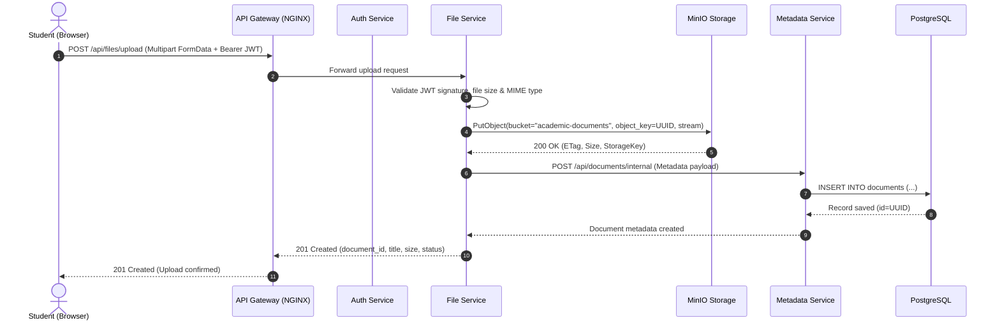
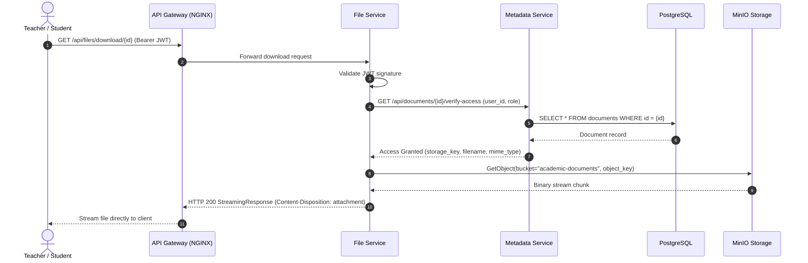

# System Architecture & Service Specifications

## 1. High-Level System Architecture

This project implements a cloud-native, microservices-based academic document submission platform engineered to investigate and benchmark **Kubernetes Pod Affinity and Anti-Affinity** policies under dynamic, concurrent workloads.

```mermaid
flowchart TD
    subgraph ClientLayer ["Client Layer"]
        UserBrowser["Web Browser (React.js Frontend)"]
        LocustClients["Locust Load Generator"]
    end

    subgraph IngressGateway ["Gateway & Ingress Layer"]
        NginxGateway["API Gateway (NGINX Reverse Proxy :80)"]
    end

    subgraph StatelessMicroservices ["Stateless Microservices Layer"]
        AuthSvc["Auth Service (:8001)<br/>FastAPI | JWT | RBAC"]
        FileSvc["File Service (:8002)<br/>FastAPI | MinIO SDK | Streaming"]
        MetaSvc["Metadata Service (:8003)<br/>FastAPI | PostgreSQL ORM | K8s API Proxy"]
    end

    subgraph StatefulStorage ["Persistent Storage Layer"]
        PostgresDB[("PostgreSQL 16 (:5432)<br/>Users & Metadata")]
        MinioStore[("MinIO Object Storage (:9000)<br/>Raw Document Blobs")]
    end

    subgraph Observability ["Observability & Metrics"]
        Prometheus["Prometheus Server (:9090)"]
        Grafana["Grafana Dashboards (:3000)"]
        MetricsServer["Kubernetes Metrics Server"]
    end

    UserBrowser -->|HTTP / REST| NginxGateway
    LocustClients -->|Simulated Workloads| NginxGateway

    NginxGateway -->|/api/auth/*| AuthSvc
    NginxGateway -->|/api/files/*| FileSvc
    NginxGateway -->|/api/documents/*| MetaSvc
    NginxGateway -->|/api/cluster/*| MetaSvc

    AuthSvc -->|Read/Write User Accounts| PostgresDB
    FileSvc -->|Stream Files (Upload/Download)| MinioStore
    FileSvc -->|Sync Validation & Metadata Registration| MetaSvc
    MetaSvc -->|Read/Write Document Records| PostgresDB
    MetaSvc -->|Cluster Topology Inspection| MetricsServer

    Prometheus -->|Scrape Metrics /metrics| AuthSvc
    Prometheus -->|Scrape Metrics /metrics| FileSvc
    Prometheus -->|Scrape Metrics /metrics| MetaSvc
    Prometheus -->|Scrape Node/Pod Metrics| MetricsServer
    Grafana -->|Query Metrics| Prometheus
```

---

## 2. Microservice Responsibilities & Boundaries

| Component | Port | Technology | Primary Responsibilities | Dependencies |
| :--- | :---: | :--- | :--- | :--- |
| **API Gateway** | 80 | NGINX | • Central reverse proxy & SSL/HTTP ingress<br/>• Request routing to backend services<br/>• Rate limiting & request timeout handling<br/>• Standardized CORS & error headers | Auth, File, Metadata services |
| **Auth Service** | 8001 | Python FastAPI | • User registration & login<br/>• Password hashing using bcrypt<br/>• JWT token generation & signature verification<br/>• Role-based Access Control (Student, Teacher, Admin) | PostgreSQL |
| **File Service** | 8002 | Python FastAPI | • Binary chunked file upload & streaming download<br/>• File MIME type & file size boundary validation<br/>• Direct high-speed interaction with MinIO<br/>• Coordinates with Metadata Service to ensure data consistency | MinIO, Metadata Service |
| **Metadata Service** | 8003 | Python FastAPI | • Document metadata persistence (schema, ownership, tags)<br/>• Search, filter, and document listing APIs<br/>• Audit access logging (upload, download, delete)<br/>• Kubernetes API client for live node/pod topology reporting | PostgreSQL, K8s Core API |
| **PostgreSQL** | 5432 | PostgreSQL 16 | • Relational database for accounts & document metadata<br/>• Persistent Volume Claim (PVC) backed | Storage Class (hostpath / local) |
| **MinIO** | 9000 | MinIO | • S3-compatible distributed object storage<br/>• Multi-part chunked object persistence<br/>• Isolated bucket `academic-documents` with PVC | Storage Class (hostpath / local) |
| **Frontend** | 3000/80 | React.js / Vite | • Student submission portal & Teacher grading dashboard<br/>• Live Kubernetes placement topology map<br/>• Placement strategy switcher & Locust benchmark viewer | API Gateway |

---

## 3. Communication Flows

### A. Document Upload Workflow



### B. Document Download Workflow



---

## 4. Architectural Resilience & Failure Domains

1. **State Independence:** Stateless microservices (`auth-service`, `file-service`, `metadata-service`) contain zero local disk state. They can be killed, restarted, or rescheduled across any node without data loss.
2. **Stateful Durability:** PostgreSQL and MinIO are backed by Kubernetes `PersistentVolumeClaim`s. In kind, these bind to persistent storage paths so that node restarts do not lose committed database transactions or object blobs.
3. **Network Isolation:** Microservices do not expose raw container IPs. All internal service communication traverses Kubernetes ClusterIP Services (`http://postgres-service:5432`, `http://minio-service:9000`, `http://metadata-service:8003`).
