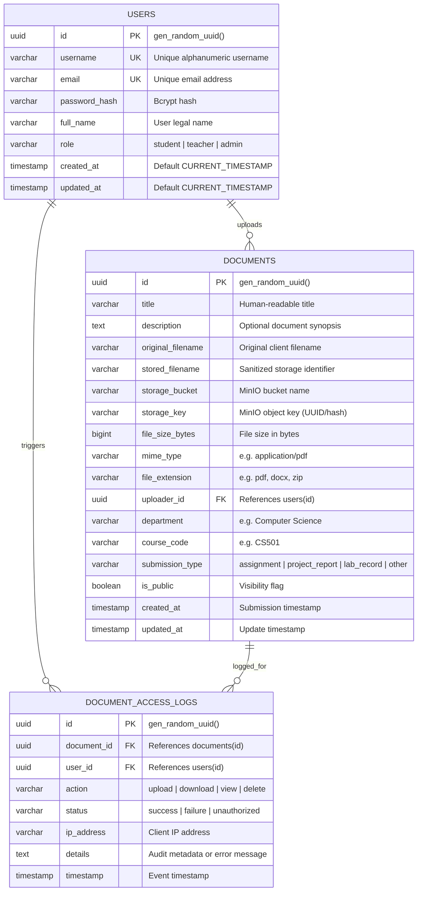

# Database Schema & Storage Specifications

## 1. Entity-Relationship Diagram



---

## 2. PostgreSQL DDL Specifications

```sql
-- Enable UUID extension
CREATE EXTENSION IF NOT EXISTS "uuid-ossp";
CREATE EXTENSION IF NOT EXISTS "pgcrypto";

-- Table: users
CREATE TABLE IF NOT EXISTS users (
    id UUID PRIMARY KEY DEFAULT gen_random_uuid(),
    username VARCHAR(50) UNIQUE NOT NULL,
    email VARCHAR(255) UNIQUE NOT NULL,
    password_hash VARCHAR(255) NOT NULL,
    full_name VARCHAR(100) NOT NULL,
    role VARCHAR(20) NOT NULL CHECK (role IN ('student', 'teacher', 'admin')),
    created_at TIMESTAMP WITH TIME ZONE DEFAULT CURRENT_TIMESTAMP,
    updated_at TIMESTAMP WITH TIME ZONE DEFAULT CURRENT_TIMESTAMP
);

CREATE INDEX IF NOT EXISTS idx_users_username ON users(username);
CREATE INDEX IF NOT EXISTS idx_users_role ON users(role);

-- Table: documents
CREATE TABLE IF NOT EXISTS documents (
    id UUID PRIMARY KEY DEFAULT gen_random_uuid(),
    title VARCHAR(255) NOT NULL,
    description TEXT,
    original_filename VARCHAR(255) NOT NULL,
    stored_filename VARCHAR(255) NOT NULL,
    storage_bucket VARCHAR(100) NOT NULL DEFAULT 'academic-documents',
    storage_key VARCHAR(255) UNIQUE NOT NULL,
    file_size_bytes BIGINT NOT NULL CHECK (file_size_bytes > 0),
    mime_type VARCHAR(100) NOT NULL,
    file_extension VARCHAR(20) NOT NULL,
    uploader_id UUID NOT NULL REFERENCES users(id) ON DELETE CASCADE,
    department VARCHAR(100) NOT NULL,
    course_code VARCHAR(50) NOT NULL,
    submission_type VARCHAR(50) NOT NULL CHECK (submission_type IN ('assignment', 'project_report', 'lab_record', 'other')),
    is_public BOOLEAN NOT NULL DEFAULT FALSE,
    created_at TIMESTAMP WITH TIME ZONE DEFAULT CURRENT_TIMESTAMP,
    updated_at TIMESTAMP WITH TIME ZONE DEFAULT CURRENT_TIMESTAMP
);

CREATE INDEX IF NOT EXISTS idx_documents_uploader ON documents(uploader_id);
CREATE INDEX IF NOT EXISTS idx_documents_course ON documents(course_code);
CREATE INDEX IF NOT EXISTS idx_documents_submission_type ON documents(submission_type);
CREATE INDEX IF NOT EXISTS idx_documents_created_at ON documents(created_at DESC);

-- Table: document_access_logs
CREATE TABLE IF NOT EXISTS document_access_logs (
    id UUID PRIMARY KEY DEFAULT gen_random_uuid(),
    document_id UUID REFERENCES documents(id) ON DELETE SET NULL,
    user_id UUID REFERENCES users(id) ON DELETE SET NULL,
    action VARCHAR(20) NOT NULL CHECK (action IN ('upload', 'download', 'view', 'delete')),
    status VARCHAR(20) NOT NULL CHECK (status IN ('success', 'failure', 'unauthorized')),
    ip_address VARCHAR(45),
    details TEXT,
    timestamp TIMESTAMP WITH TIME ZONE DEFAULT CURRENT_TIMESTAMP
);

CREATE INDEX IF NOT EXISTS idx_access_logs_doc ON document_access_logs(document_id);
CREATE INDEX IF NOT EXISTS idx_access_logs_user ON document_access_logs(user_id);
CREATE INDEX IF NOT EXISTS idx_access_logs_timestamp ON document_access_logs(timestamp DESC);
```

---

## 3. MinIO Object Storage Structure

All academic files are stored in the bucket **`academic-documents`**.

Object Key Scheme:
```
academic-documents/
  └── {department}/
      └── {course_code}/
          └── {submission_type}/
              └── {document_uuid}_{sanitized_original_name}
```

Example Object Key:
`academic-documents/cse/cs501/lab_record/8f4c2e64-4e9b-4e89-a2e6-a07bf3d99432_Experiment_02_Report.pdf`

This hierarchy guarantees:
1. No object name collisions even when multiple students upload files named `Report.pdf`.
2. Safe access control mapping between database records and storage buckets.
3. Rapid path-based bucket lifecycle and auditing queries.
